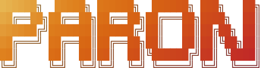

<h1 align="center">
  
  
</h1>

<p align="center">
  <b>The boss of your machines.</b><br />
  Self-hosted SSH access for your team. No open ports. No VPN. No keys on laptops.
</p>

<p align="center">
  <a href="https://paron.bovolato.dev">Website</a> ·
  <a href="https://paron.bovolato.dev/docs">Documentation</a>
</p>

---

Paron is a self-hosted SSH gateway in one binary. You add a machine, and you open a terminal on it
from the browser. Paron keeps the credentials, and it controls who has access.

A machine can be anywhere. If Paron cannot reach it directly, the machine connects out to Paron
through a reverse tunnel. Paron connects over SSH, and it does not record the sessions.

"Paron" is Venetian for "boss".

> **⚠️ NOTE:**
> Paron is in early development.

## What it does

- **One binary.** The control plane, the web UI and the tunnel broker are the same program. There
  is no database server and no second service.
- **Little or no configuration.** Paron sets itself up at the first start. It issues its own
  certificate, or it gets one from Let's Encrypt.
- **Machines behind NAT.** A machine connects out to Paron through a reverse tunnel, with the same
  `paron` program. It opens no port, and Paron binds no port for each machine.
- **A terminal in the browser.** Open a shell on a machine from the web UI, also from a phone.
- **Credentials in one place.** A password, a private key that you import, or a key that Paron
  generates and keeps. The users do not get the credentials.
- **Users and roles.** Each user gets only the access that their role gives.

## Install

### With the binary

Install `paron`, and set up the server:

```sh
curl -fsSL https://paron.bovolato.dev/install.sh | sh
paron server bootstrap
```

On Windows, in PowerShell as administrator:

```powershell
irm https://paron.bovolato.dev/install.ps1 | iex
paron server bootstrap
```

See [Install with the binary](https://paron.bovolato.dev/docs/get-started/install-with-the-binary/).

### With Docker

Get [`docker-compose.server.yml`](crates/paron-cli/examples/docker-compose.server.yml), and set
`PARON_PUBLIC_URL`, `PARON_LETSENCRYPT` and `PARON_ACME_CONTACT`. The URLs are the ones that your browser
and your machines use for Paron, and the first one is in links. If no URL has a public domain,
remove the two lines for Let's Encrypt. Then start it:

```sh
docker compose -f docker-compose.server.yml up -d
```

See [Install with Docker](https://paron.bovolato.dev/docs/get-started/install-with-docker/).

## Contributing

See [CONTRIBUTING.md](CONTRIBUTING.md). Each contribution needs agreement to the
[Contributor License Agreement](CLA.md).

## License

Paron is source-available under the [PolyForm Shield License 1.0.0](LICENSE). The
[license FAQ](LICENSE_FAQ.md) explains what you can do with it.
